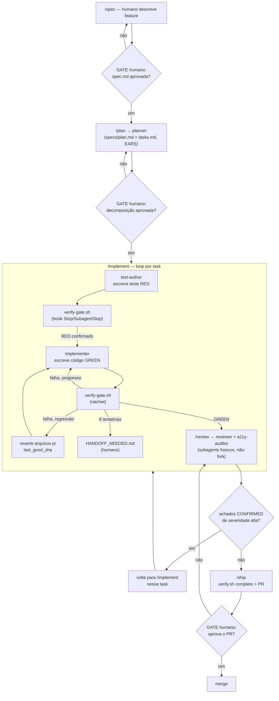

# AGENT_ARCHITECTURE.md

> Fase 2 do BUILD_FRONTEND_AGENT_TEMPLATE. Arquitetura do harness — ainda sem código de aplicação. Toda decisão opinativa aqui referencia um ADR em `docs/meta/DECISIONS.md`. Toda afirmação de fato sobre o Claude Code/Copilot referencia `docs/meta/FINDINGS.md`.
>
> **Premissa de compatibilidade (ADR-001, ADR-002, ADR-003):** o núcleo (specs/, `scripts/verify.sh`, metodologia SDD) é agnóstico de agente. Claude Code é o harness de referência (camada completa: hooks, subagents, skills). GitHub Copilot recebe adapters finos, com dois pontos de convergência real — `CLAUDE.md` como arquivo único de instruções, e `.claude/agents/*.md` como diretório único de subagents (o VS Code Copilot lê ambos nativamente, `docs/meta/FINDINGS.md` §2.5). Onde o Copilot não tem equivalente confiável (Skills, hooks na extensão VS Code), `scripts/verify.sh` rodando em CI + git hooks tradicionais é o gate universal — nenhum harness nativo é a fonte de verdade final.

---

## 3.1 Modelo de papéis (subagents)

### Princípio de aninhamento e escopo

- **Profundidade máxima: 1 nível a partir da sessão principal.** Nenhum subagent do roster abaixo recebe a ferramenta `Agent` no frontmatter — tecnicamente incapazes de spawnar filhos. Isso é reforçado em `.claude/settings.json` com `CLAUDE_CODE_MAX_SUBAGENT_SPAWN_DEPTH=1` como defesa em profundidade (mesmo que alguém adicione `Agent` a um subagent por engano, o limite do harness ainda bloqueia). **Razão:** o Copilot não documenta profundidade de aninhamento configurável para `.github/agents/*.agent.md` (`docs/meta/FINDINGS.md` §2.5) — desenhar para o caso mais restrito (Copilot, sem aninhamento) como baseline evita que o template dependa de uma capacidade que só existe num dos dois harnesses. A sessão principal (orquestrador humano+Claude) é o único nível autorizado a fazer fan-out de pesquisa (`Explore`/fork) fora deste roster.
- **Isolamento de contexto:** todos os subagents do roster são invocados como **subagent fresco** (sem herança de contexto — não `context: fork`), exceto onde explicitado. Isso é obrigatório para `reviewer` (ver abaixo) e é o default recomendado para os demais, já que cada um só precisa do estado do repositório + do artefato relevante (spec, task, diff), não da conversa inteira que os gerou — mantém contexto mínimo (economia de tokens, `docs/meta/FINDINGS.md` §2.2.7).
- **Orçamento de tokens por papel:** ver tabela na §3.5. Nenhum subagent tem acesso a `Agent`, então o orçamento por papel é também o orçamento por nível 1 — não existe nível 2 neste template.

### Roster

| Papel              | Quando é spawnado                                                                                           | O que NÃO pode fazer                                                                                                              | Tools                                                                                                                                   | Model                                                                                                                                                                                                                              | Gate de retorno                                                                                                                                                                                                                                                                                                                                                  |
| ------------------ | ----------------------------------------------------------------------------------------------------------- | --------------------------------------------------------------------------------------------------------------------------------- | --------------------------------------------------------------------------------------------------------------------------------------- | ---------------------------------------------------------------------------------------------------------------------------------------------------------------------------------------------------------------------------------- | ---------------------------------------------------------------------------------------------------------------------------------------------------------------------------------------------------------------------------------------------------------------------------------------------------------------------------------------------------------------- |
| **`planner`**      | Início do fluxo `/plan`, após uma spec aprovada em `specs/`                                                 | Escrever/editar código em `src/`, `tests/`; rodar Bash arbitrário                                                                 | `Read`, `Glob`, `Grep`, `Write` (escopo: `specs/**`), `TodoWrite`                                                                       | `sonnet`, effort alto                                                                                                                                                                                                              | Produz `specs/<feature>/plan.md` + `specs/<feature>/tasks.md` com critérios em EARS; gate humano (checkpoint do `/plan`) confere se a decomposição faz sentido antes de `/tasks`→`/implement` prosseguir                                                                                                                                                         |
| **`test-author`**  | Início de cada task, antes de `implementer`                                                                 | Escrever código de implementação em `src/` (fora de mocks/fixtures necessários ao próprio teste)                                  | `Read`, `Write`/`Edit` (escopo: `tests/**`, `src/**/*.test.*`, `src/**/*.spec.*`), `Bash` (restrito ao test runner via hook — ver §3.2) | `sonnet`, effort médio                                                                                                                                                                                                             | O teste escrito **deve falhar** (RED) rodando `scripts/verify.sh --unit` antes do `implementer` começar — hook `PostToolUse` valida isso automaticamente                                                                                                                                                                                                         |
| **`implementer`**  | Após `test-author` produzir o teste RED de uma task                                                         | Editar `specs/`; pular etapas do ciclo RED→GREEN; marcar task como concluída sem `scripts/verify.sh` verde                        | `Read`, `Edit`, `Write`, `Bash`, `Grep`, `Glob`                                                                                         | `sonnet`, effort médio                                                                                                                                                                                                             | Task só é considerada feita quando `scripts/verify.sh` (pirâmide completa da task) sai `0` — gate `Stop`/`SubagentStop` (§3.2)                                                                                                                                                                                                                                   |
| **`reviewer`**     | Após `implementer` reportar GREEN, antes do `/ship`                                                         | Editar código para "corrigir" o que encontrar (só reporta); aprovar o próprio trabalho (nunca é o mesmo subagent que implementou) | `Read`, `Grep`, `Glob`, `Bash` (somente leitura: rodar `scripts/verify.sh`, testes, build — nunca `Write`/`Edit`)                       | `sonnet` default, **override para `opus` disponível por invocação** em mudanças de alto risco (auth, pagamentos, dados sensíveis)                                                                                                  | Retorna achados estruturados (verdict CONFIRMED/PLAUSIBLE por achado, severidade); **nunca invocado via `context: fork`** — precisa de contexto fresco para não herdar o viés/raciocínio de quem implementou (padrão "verificador independente", `docs/meta/FINDINGS.md` §2.1.6). Inclui explicitamente uma passada adversarial/mutation-style (ver nota abaixo) |
| **`a11y-auditor`** | Após GREEN, em paralelo com `reviewer`, para qualquer task que toque `src/components/**` ou `src/routes/**` | Editar código; aprovar merge sozinho (achados viram itens que `implementer` corrige, revalidados pelo mesmo auditor)              | `Read`, `Bash` (rodar axe-core/Playwright a11y runner), `Grep`                                                                          | `haiku` default (interpretar violações estruturadas do axe-core é majoritariamente mecânico); **escalar para `sonnet`** via override quando o achado exigir julgamento subjetivo (qualidade de `alt` text, ordem de foco complexa) | Relatório de violações WCAG mapeadas para linha/arquivo; gate bloqueia `Stop` se houver violação de nível `critical`/`serious` sem waiver documentado                                                                                                                                                                                                            |
| **`refactorer`**   | Sob demanda explícita (`/refactor` ou task marcada como refactor no plano)                                  | Mudar comportamento observável (testes existentes são o contrato); adicionar funcionalidade nova                                  | `Read`, `Edit`, `Write`, `Bash`, `Grep`, `Glob`                                                                                         | `sonnet`, effort médio                                                                                                                                                                                                             | Só conclui se a suíte de testes pré-existente continua 100% verde e sem novo teste precisou ser escrito para o comportamento (se precisou, não era refactor — é `implementer`)                                                                                                                                                                                   |

**Nota sobre "adversarial-reviewer" (item em aberto em `docs/meta/DECISIONS.md`):** a pesquisa (`docs/meta/FINDINGS.md` §2.4) validou esse papel como subagent dedicado em 2 referências (BMAD, claude-forge). Decisão desta fase: **não** criar um 7º papel — a responsabilidade de mutation-testing/achar "errado-mas-passando" (`docs/meta/FINDINGS.md` §2.2.5) fica dentro do mandato do `reviewer`, como uma etapa explícita do seu prompt de sistema, não como agente separado. Razão: manter o roster enxuto (a pesquisa de referências vivas identificou explosão de papéis como a armadilha nº1 mais recorrente — BMAD com 19-21 agentes, claude-forge com 16 — e o próprio START.MD pede roster enxuto). Se, na prática de uso do template, `reviewer` se mostrar sobrecarregado (context muito grande misturando checagem de qualidade + segurança + a11y + mutation testing), separar `adversarial-reviewer` é a primeira extensão recomendada em `docs/CUSTOMIZING.md` (Fase 3) — não um redesign.

---

## 3.2 Gates determinísticos (hooks)

### Camada Claude Code (`.claude/hooks/`)

| Evento                     | Hook                      | Comportamento                                                                                                                                                                                                           | Semântica de retorno                                                                                                |
| -------------------------- | ------------------------- | ----------------------------------------------------------------------------------------------------------------------------------------------------------------------------------------------------------------------- | ------------------------------------------------------------------------------------------------------------------- |
| `PreToolUse` (Bash)        | `guard-destructive.sh`    | Bloqueia `rm -rf` fora de paths temporários conhecidos, `git push --force`/`push -f` para branches protegidas, `git reset --hard` sem checkpoint prévio, comandos que imprimem segredos (`cat .env`, `printenv`, `env`) | `permissionDecision: deny` com mensagem explicando a alternativa seguraem                                           |
| `PreToolUse` (Write/Edit)  | `guard-scope.sh`          | Bloqueia escrita fora da raiz do repositório (paths absolutos fora do cwd, `../` escapando do worktree)                                                                                                                 | `permissionDecision: deny`                                                                                          |
| `PreToolUse` (Write/Edit)  | `guard-dangerous-html.sh` | Escaneia o conteúdo novo por `dangerouslySetInnerHTML` sem um sanitizador (`DOMPurify`, `sanitize-html`) na mesma expressão/import — bloqueia se encontrar                                                              | `permissionDecision: deny`, sugere `DOMPurify.sanitize(...)`                                                        |
| `PostToolUse` (Bash)       | `redact-secrets.sh`       | Escaneia stdout/stderr do comando por padrões de alta entropia / prefixos conhecidos de token (`sk-`, `ghp_`, `AKIA`, JWT) antes de o resultado voltar ao contexto do modelo; substitui por `[REDACTED]`                | Não bloqueia — reescreve o output via `additionalContext`/edição do payload                                         |
| `PostToolUse` (Write/Edit) | `format.sh`               | Roda `prettier --write` no arquivo editado (ESLint `--fix` quando aplicável)                                                                                                                                            | Não bloqueia (exit 0), silencioso em sucesso                                                                        |
| `Stop` / `SubagentStop`    | `verify-gate.sh`          | **O gate verde.** Ver mecânica de ratchet abaixo                                                                                                                                                                        | Bloqueia (exit 2) até `scripts/verify.sh` sair 0, o limite de tentativas do ratchet ser atingido, ou handoff humano |

### Camada Copilot (`.github/hooks/*.json`, ADR-001)

Gerados a partir da **mesma definição lógica** (um script `scripts/gen-hooks.mjs`, detalhado no roadmap da Fase 3, lê uma definição única em `.claude/hooks/definitions.json` e emite tanto os scripts de `.claude/hooks/` quanto os arquivos JSON de `.github/hooks/`). Mapeamento:

- `preToolUse` (Copilot) ← mesma lógica de `guard-destructive.sh`/`guard-scope.sh`/`guard-dangerous-html.sh`.
- `postToolUse` (Copilot) ← `format.sh`.
- `agentStop`/`subagentStop` (Copilot) ← `verify-gate.sh`.

**Ressalva documentada (ADR-001):** cobertura de hooks nativos do Copilot é confirmada só para Copilot CLI e coding agent (cloud) — **não confirmada** na extensão VS Code (`docs/meta/FINDINGS.md` §2.5, item 5). Por isso os hooks do Copilot são tratados como **otimização de feedback rápido**, nunca como o gate que decide "pronto".

### O gate universal: `scripts/verify.sh` via CI

Independente de qual agente (ou humano) fez a mudança, `scripts/verify.sh` roda em GitHub Actions em todo PR, e um git hook `pre-push` (husky ou lefthook — decisão de ferramenta específica fica para Fase 3) roda a versão rápida localmente. **Isso é o gate que realmente importa** quando um dos dois harnesses nativos falha silenciosamente em bloquear.

### Mecânica de ratchet (detalhamento da Fase 2, resolve item em aberto de `docs/meta/DECISIONS.md`)

Estado persistido em `.claude/state/verify-ratchet.json` (gitignored, efêmero por branch de trabalho):

```json
{
  "last_good_sha": "<git sha>",
  "last_failure_count": <int>,
  "attempts_this_task": <int>
}
```

Algoritmo do `verify-gate.sh` a cada disparo de `Stop`/`SubagentStop`:

1. Roda `scripts/verify.sh --json`, captura exit code e uma contagem estruturada de falhas (soma de: erros de typecheck + erros de lint + testes falhando + falhas de build + violações a11y críticas).
2. **Exit 0 (verify passou):** grava `last_good_sha = HEAD`, zera `last_failure_count` e `attempts_this_task`, hook sai `0` — turno pode terminar.
3. **Exit ≠0 e `failure_count < last_failure_count` (progresso real):** hook bloqueia (exit 2) com a lista de falhas restantes, incrementa `attempts_this_task`, atualiza `last_failure_count`. **Não reverte** — o agente está convergindo, deixa continuar.
4. **Exit ≠0 e `failure_count >= last_failure_count` (regressão ou estagnação):** hook executa `git diff --stat HEAD` para isolar os arquivos tocados neste turno e `git checkout -- <arquivos>` (reversão cirúrgica, não `reset --hard` do repo inteiro) restaurando o estado de `last_good_sha` para esses arquivos; bloqueia (exit 2) com mensagem explícita: _"Sua última mudança piorou o resultado (X falhas → Y falhas). Revertido para o último estado bom. Tente uma abordagem diferente."_
5. **`attempts_this_task >= 6`:** hook para de bloquear tecnicamente (exit 0, deixa o turno terminar) mas escreve um arquivo `specs/<feature>/HANDOFF_NEEDED.md` com o histórico de tentativas — **handoff humano**, antes de bater no cap nativo de 8 bloqueios consecutivos do Claude Code (`docs/meta/FINDINGS.md` §2.1.4), para terminar de forma graciosa em vez de ser forçado pelo harness.

Isso implementa exatamente as **3 saídas válidas** do "Verification Loop" da pesquisa (§2.2.3): verify 0, limite atingido, handoff humano — nunca uma 4ª saída onde o agente "se declara pronto" por conta própria.

---

## 3.3 Skills (expertise sob demanda)

Empacotadas como `.claude/skills/<nome>/SKILL.md` (padrão Agent Skills, `docs/meta/FINDINGS.md` §2.1.2). Todas com `description` objetiva (carregada sempre, custo baixo) e conteúdo completo só sob demanda.

| Skill                         | Quando é relevante (gatilho)                                                | Conteúdo essencial                                                                                                                                                                         |
| ----------------------------- | --------------------------------------------------------------------------- | ------------------------------------------------------------------------------------------------------------------------------------------------------------------------------------------ |
| `component-conventions`       | Criar/editar qualquer componente em `src/components/**` (`paths` glob)      | Estrutura de arquivo por componente, convenção de props/types, padrão de composição, quando usar Base UI vs compor do zero                                                                 |
| `routing-tanstack-router`     | Mexer em `src/routes/**` ou pedido menciona rotas/navegação/search params   | File-based routing, validação de search params via Standard Schema (Zod/Arktype sem adapter — `docs/meta/FINDINGS.md` §2.3), loaders, error boundaries por rota                            |
| `server-state-tanstack-query` | Pedido envolve fetch de dados, cache, mutações                              | Convenção de query keys, `useSuspenseQuery` vs `useQuery`, invalidação, optimistic updates                                                                                                 |
| `client-state-zustand`        | Pedido envolve estado compartilhado de UI (não servidor)                    | Quando Zustand vs Context, padrão de slice/store, evitar over-fetching de estado global                                                                                                    |
| `forms-validation`            | Pedido envolve formulário/input do usuário                                  | Schema Zod na fronteira, integração com TanStack Form ou equivalente, mensagens de erro acessíveis                                                                                         |
| `styling-tailwind-v4`         | Qualquer edição de classe/tema Tailwind                                     | Config CSS-first via `@theme`, tokens OKLCH, convenção de variantes (cva/tailwind-variants)                                                                                                |
| `testing-rtl-msw`             | `test-author` sempre carrega; qualquer edição em `tests/**`                 | Padrão RTL (queries por acessibilidade, não por `data-testid` como primeira opção), setup MSW por handler, o que é "coberto" (ver `docs/CUSTOMIZING.md`/contrato de testabilidade da SPEC) |
| `a11y-checklist`              | `a11y-auditor` sempre carrega; qualquer componente interativo               | Checklist WCAG 2.2 AA resumido, padrões de foco/teclado, quando um achado é `critical` vs `minor`                                                                                          |
| `error-handling`              | Pedido envolve tratamento de erro/exceção/fallback de UI                    | Error boundaries, Sentry (captura + contexto), padrão de mensagem de erro voltada ao usuário vs log técnico                                                                                |
| `openapi-codegen`             | Existe uma spec OpenAPI no projeto e o pedido envolve consumir uma API nova | Fluxo Orval (config, regeneração, onde ficam os tipos gerados — nunca editados à mão)                                                                                                      |

**Nota de economia:** 10 skills é deliberadamente enxuto (vs. dezenas em kits como sangrokjung/claude-forge, `docs/meta/FINDINGS.md` §2.4). Cada skill cobre uma camada específica do preset de stack — trocar uma camada (ex.: Base UI → Radix puro, Zustand → Jotai) é editar/substituir a skill correspondente, documentado em `docs/CUSTOMIZING.md` (Fase 3), não redesenhar o roster.

---

## 3.4 Comandos / workflows

Forma canônica: **Skills com `user-invocable: true`** (`.claude/skills/<comando>/SKILL.md`, `docs/meta/FINDINGS.md` §2.1.1 — commands foram fundidas em Skills). Cada um com adapter espelho em `.github/prompts/<comando>.prompt.md` (ADR-001).

| Comando      | O que faz                                                                                                           | Checkpoint humano?                                                                                                  |
| ------------ | ------------------------------------------------------------------------------------------------------------------- | ------------------------------------------------------------------------------------------------------------------- |
| `/spec`      | Cria `specs/<feature>/spec.md` a partir de uma descrição em linguagem natural, em EARS onde há critério de aceite   | Sim — humano revisa antes de `/plan`                                                                                |
| `/plan`      | Spawna `planner`, produz `plan.md` + `tasks.md`                                                                     | Sim — humano aprova a decomposição antes de `/implement`                                                            |
| `/tasks`     | Só relista/reordena `tasks.md` existente (sem spawnar `planner` de novo) — usado para ajuste manual leve            | Não (edição direta, revisável via diff)                                                                             |
| `/implement` | Roda o ciclo `test-author`→`implementer` task a task, respeitando `verify-gate.sh` a cada task                      | Não — é o próprio loop com ratchet automático; humano pode interromper a qualquer momento                           |
| `/tdd`       | Atalho para rodar só o ciclo `test-author`→`implementer` de **uma** task específica (fora do batch de `/implement`) | Não                                                                                                                 |
| `/review`    | Spawna `reviewer` + `a11y-auditor` em paralelo sobre o diff atual                                                   | Sim — achados `CONFIRMED` de severidade alta bloqueiam `/ship` até resolvidos ou explicitamente aceitos pelo humano |
| `/ship`      | Roda `scripts/verify.sh` completo, confere que `/review` não tem pendência bloqueante, abre PR                      | Sim — é o gate final antes de sair do controle do agente                                                            |

---

## 3.5 Orçamento de tokens e observabilidade

### Orçamento por papel (nível 1, único nível existente)

| Papel          | Budget alvo por invocação | Alerta em | Hard stop em                                                                     |
| -------------- | ------------------------- | --------- | -------------------------------------------------------------------------------- |
| `planner`      | 50k tokens                | 40k (80%) | 70k — retorna plano parcial + nota do que falta                                  |
| `test-author`  | 20k                       | 16k       | 30k                                                                              |
| `implementer`  | 60k por task              | 48k       | 90k — dispara `HANDOFF_NEEDED.md` mesmo sem bater o cap de tentativas do ratchet |
| `reviewer`     | 40k                       | 32k       | 60k                                                                              |
| `a11y-auditor` | 20k                       | 16k       | 30k                                                                              |
| `refactorer`   | 40k                       | 32k       | 60k                                                                              |

Números são _default trocável_ (`docs/CUSTOMIZING.md`, Fase 3) — dependem do tamanho médio de task do projeto real que clonar o template.

### Métricas instrumentadas

Um hook `PostToolUse`/`Stop` leve (`.claude/hooks/log-metrics.sh`) acrescenta uma linha a `.claude/logs/metrics.jsonl` (gitignored) por invocação de subagent: `{ts, role, model, tokens_in, tokens_out, cache_read_tokens, tool_call_count, verify_attempts, outcome}`. `docs/TOKEN_BUDGET.md` (Fase 3) documenta como agregar isso (ex.: `jq` one-liner) para custo por task e cache hit rate — sem exigir infraestrutura externa de observabilidade no template base (Sentry cobre erros de runtime da aplicação, não custo do agente).

### O que acontece ao estourar o limite

Alerta (80%) é só um `systemMessage` injetado no hook, não bloqueia. Hard stop força o subagent a retornar o que tem + um resumo do que falta, e marca a task como `blocked: token_budget` em `tasks.md` — vira item de handoff humano, mesma via de saída que o ratchet de `verify-gate.sh` (§3.2), não uma saída nova.

### Cache

Per `docs/meta/FINDINGS.md` §2.1.9: subagents usam TTL de 5min por padrão mesmo em assinatura. Para papéis reinvocados com frequência dentro de um mesmo `/implement` em batch (`test-author`, `implementer` chamados task após task com o mesmo prefixo de sistema) recomenda-se `experimental.cacheTtl: "1h"` no frontmatter (requer Claude Code v2.1.248+, checar na Fase 3 se a versão instalada suporta) — reduz custo de escrita repetida de cache entre tasks do mesmo `/implement`.

---

## 3.6 CLAUDE.md enxuto

Conteúdo do `CLAUDE.md` do template (< 200 linhas, `docs/meta/FINDINGS.md` §2.1.1; é o mesmo arquivo lido pelo Copilot, ADR-002):

1. **Uma frase de missão** do projeto (placeholder genérico, substituído na customização).
2. **Tabela de comandos disponíveis** (§3.4) com 1 linha cada — aponta para a skill, não repete o conteúdo.
3. **As 3 regras inegociáveis** em prosa curta: (a) nada é "pronto" sem `scripts/verify.sh` verde; (b) TDD é obrigatório — teste antes de código; (c) `reviewer` nunca é a mesma sessão que implementou.
4. **Ponteiro para skills** ("para convenções de componente, roteamento, estado, estilo, testes e a11y, veja `.claude/skills/` — carregadas automaticamente quando relevante, não precisa ler manualmente").
5. **Ponteiro para `docs/CUSTOMIZING.md`** para quem clonou o template e precisa trocar uma peça do preset.

Nada de stack trace de decisões, nada de changelog, nada de exemplo de código extenso — isso vive em skills/specs.

### Política de `/compact`

**Preservar:** caminho do arquivo de plano/task ativo (`specs/<feature>/tasks.md`), a task em progresso e seu status de `verify-gate.sh` (falha atual, não o histórico completo de tentativas), bloqueios/decisões abertas ainda não resolvidas.
**Descartar:** saída completa de ferramentas já processada (resultado de `Read`/`Bash` já incorporado ao raciocínio), exploração superada por uma decisão já tomada, texto de skills já carregado (pode recarregar sob demanda de novo se precisar).

---

## Diagrama do pipeline



---

## Rastreabilidade de decisões desta fase

- ADR-001, ADR-002, ADR-003 (`docs/meta/DECISIONS.md`) definem a base de compatibilidade dupla usada em todo este documento.
- A decisão de **não** criar um 7º papel `adversarial-reviewer` (§3.1) e o detalhamento exato do **ratchet** (§3.2) resolvem os 2 primeiros itens em aberto listados em `docs/meta/DECISIONS.md`. Os 2 itens restantes (Base UI vs Radix; Vite+/Rolldown/Oxfmt como watch items) são decisões de **stack**, não de **harness** — ficam para a Fase 3 (SPEC.md), não bloqueiam esta arquitetura.
